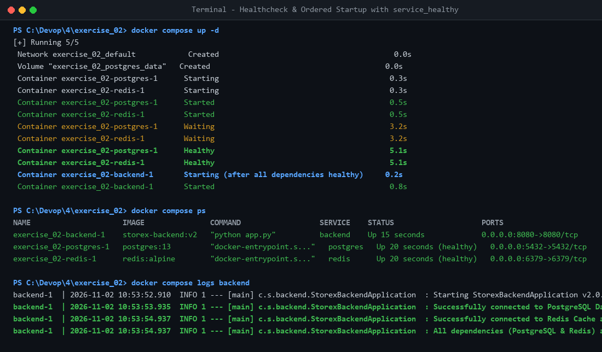
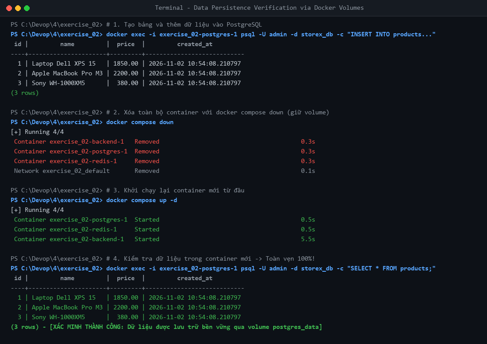

# StoreX DevOps Practice - Session 04: Docker Compose Ecosystem

- **Học viên:** NamNT (NamNTHE176286)
- **Repository:** [NamNT2942003/4](https://github.com/NamNT2942003/4)
- **Dự án thực hành:** StoreX Microservices Architecture (Backend Spring Boot, PostgreSQL, Redis)

---

## Danh mục bài tập hoàn thành (Session 04)

| Bài tập | Nội dung | File bàn giao | Minh chứng |
| :--- | :--- | :--- | :--- |
| **Bài tập 1** | Khởi tạo môi trường phát triển cơ bản & Sửa lỗi kết nối mạng (Service Name DNS) | `exercise_01/docker-compose.yml`, `README.md` | `evidence_01_error.png`<br>`evidence_02_success.png` |
| **Bài tập 2** | Quản lý dữ liệu bền vững (Volumes) và Dependency với Healthcheck (`service_healthy`) | `exercise_02/docker-compose.yml`, `HEALTHCHECK_EXPLANATION.md` | `evidence_01_startup_dependency.png`<br>`evidence_02_data_persistence.png` |

---

## Chi tiết Bài tập 2: Quản lý dữ liệu (Volumes) & Dependency với Healthcheck

### 1. Phân tích vấn đề kỹ thuật
1. **Lỗi Crash Backend do Race Condition:**
   - Mặc định `depends_on: [postgres, redis]` chỉ đợi container ở trạng thái `running` (hệ điều hành đã khởi tạo process).
   - PostgreSQL cần từ 5 - 15 giây để khởi tạo database cluster, chạy bootstrap script, cấp quyền và mở cổng socket tiếp nhận kết nối.
   - Redis cần thời gian load dataset và bind port `6379`.
   - Backend khởi động ngay khi các container phụ thuộc vừa start -> Kết nối bị từ chối (`Connection refused`) -> Crash loop.
2. **Lỗi Mất mát Dữ liệu (Data Loss):**
   - Không cấu hình Volume khiến toàn bộ dữ liệu PostgreSQL được lưu trữ tạm thời trong writable container layer. Khi thực hiện `docker-compose down`, container bị hủy bỏ và toàn bộ dữ liệu bị xóa sạch.

### 2. Cấu hình hoàn chỉnh (`exercise_02/docker-compose.yml`)

```yaml
version: '3.8'

services:
  backend:
    image: storex-backend:v2
    ports:
      - "8080:8080"
    environment:
      - SPRING_DATASOURCE_URL=jdbc:postgresql://postgres:5432/storex_db
      - SPRING_DATASOURCE_USERNAME=admin
      - SPRING_DATASOURCE_PASSWORD=admin
      - SPRING_REDIS_HOST=redis
      - SPRING_REDIS_PORT=6379
    depends_on:
      postgres:
        condition: service_healthy
      redis:
        condition: service_healthy

  postgres:
    image: postgres:13
    ports:
      - "5432:5432"
    environment:
      - POSTGRES_DB=storex_db
      - POSTGRES_USER=admin
      - POSTGRES_PASSWORD=admin
    volumes:
      - postgres_data:/var/lib/postgresql/data
    healthcheck:
      test: ["CMD-SHELL", "pg_isready -U admin -d storex_db"]
      interval: 5s
      timeout: 5s
      retries: 5
      start_period: 10s

  redis:
    image: redis:alpine
    ports:
      - "6379:6379"
    healthcheck:
      test: ["CMD", "redis-cli", "ping"]
      interval: 5s
      timeout: 3s
      retries: 5
      start_period: 5s

volumes:
  postgres_data:
    driver: local
```

### 3. Minh chứng thực nghiệm

#### 3.1. Khởi động tuần tự theo Healthcheck (`condition: service_healthy`)


- `postgres-1` và `redis-1` khởi động trước và chuyển sang trạng thái `healthy`.
- `backend-1` chỉ khởi động sau khi cả hai container phụ thuộc đã `healthy`.

#### 3.2. Kiểm chứng dữ liệu bền vững (Data Persistence qua Volume)


1. Tạo bảng `products` và chèn 3 bản ghi mẫu vào PostgreSQL.
2. Thực hiện `docker compose down` xóa sạch toàn bộ container.
3. Khởi chạy lại với `docker compose up -d`.
4. Truy vấn `SELECT * FROM products;` -> **Dữ liệu vẫn còn nguyên vẹn 100%!**

---

## Chi tiết Bài tập 1: Khởi tạo môi trường phát triển cơ bản

### 1. Nguyên nhân lỗi kết nối `localhost`
- Trong Docker, `localhost` bên trong container trỏ về chính loopback interface (`127.0.0.1`) của container đó.
- Để giao tiếp giữa các container trong cùng mạng bridge, cần sử dụng **Service Name** do Docker Embedded DNS phân giải: `jdbc:postgresql://postgres:5432/storex`.

### 2. Minh chứng thực nghiệm
- **Minh chứng lỗi ban đầu:** `exercise_01/evidence_01_error.png`
- **Minh chứng sửa thành công:** `exercise_01/evidence_02_success.png`
