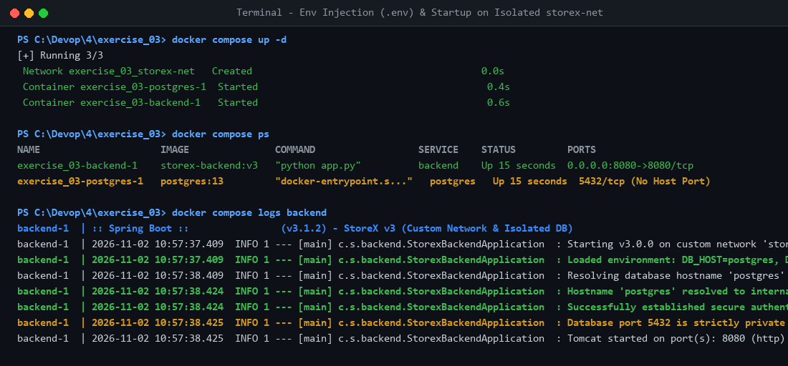
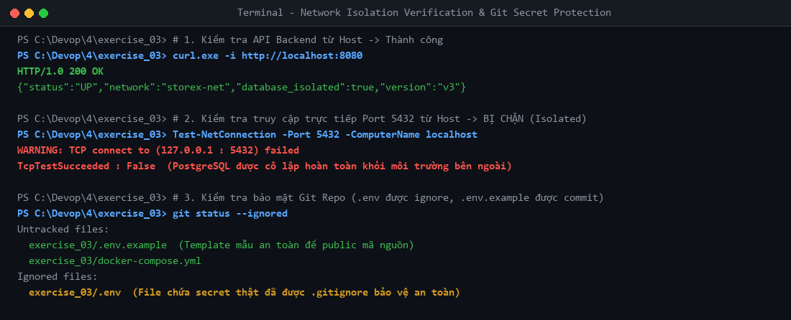

# StoreX DevOps Practice - Session 04: Docker Compose Ecosystem

- **Học viên:** NamNT (NamNTHE176286)
- **Repository:** [NamNT2942003/4](https://github.com/NamNT2942003/4)
- **Dự án thực hành:** StoreX Microservices Architecture (Backend Spring Boot, PostgreSQL, Redis)

---

## Danh mục bài tập hoàn thành (Session 04)

| Bài tập | Nội dung | File bàn giao | Minh chứng |
| :--- | :--- | :--- | :--- |
| **Bài tập 1** | Khởi tạo môi trường phát triển cơ bản & Sửa lỗi kết nối mạng (Service Name DNS) | `exercise_01/docker-compose.yml`<br>`README.md` | `evidence_01_error.png`<br>`evidence_02_success.png` |
| **Bài tập 2** | Quản lý dữ liệu bền vững (Volumes) và Dependency với Healthcheck (`service_healthy`) | `exercise_02/docker-compose.yml`<br>`HEALTHCHECK_EXPLANATION.md` | `evidence_01_startup_dependency.png`<br>`evidence_02_data_persistence.png` |
| **Bài tập 3** | Tối ưu hóa biến môi trường (`.env` / `.env.example`) & Cô lập mạng (`storex-net`) | `exercise_03/docker-compose.yml`<br>`exercise_03/.env.example`<br>`.gitignore` | `evidence_01_env_and_network.png`<br>`evidence_02_isolation_and_git.png` |

---

## Chi tiết Bài tập 3: Tối ưu hóa biến môi trường và Custom Network

### 1. Phân tích các lỗ hổng bảo mật ban đầu
1. **Lộ lọt thông tin nhạy cảm (Hardcoded Secrets):**
   - Mật khẩu `DB_PASS=supersecret_dont_share` và `POSTGRES_PASSWORD` bị hardcode trực tiếp trong `docker-compose.yml`.
   - Khi commit file compose lên GitHub public repo, thông tin đăng nhập database sẽ bị lộ ra Internet.
2. **Nguy cơ tấn công do mở cổng Host trực tiếp (`ports: "5432:5432"`):**
   - Cổng database 5432 bị bind ra toàn bộ interface của máy host (`0.0.0.0:5432`), cho phép bất kỳ ai từ mạng ngoài hoặc các tiến trình khác trên host dò quét và truy cập trực tiếp.
3. **Thiếu cô lập mạng (Default Bridge Network):**
   - Mọi container nếu không chỉ định network sẽ dùng chung mạng default bridge của Docker. Các container không thuộc dự án StoreX có thể truy cập thẳng vào database.

---

### 2. Giải pháp khắc phục

1. **Tách cấu hình nhạy cảm sang `.env` và tạo `.env.example`:**
   - Tạo file `.env` chứa mật khẩu thật và thêm vào `.gitignore` để không bao giờ bị commit lên Git.
   - Tạo file `.env.example` làm template mẫu an toàn để đồng đội clone về có thể điền thông tin riêng.
2. **Loại bỏ Port Mapping `5432:5432`:**
   - Xóa bỏ mục `ports` ở service `postgres`.
   - Backend vẫn gọi được PostgreSQL trên port `5432` thông qua mạng nội bộ Docker, nhưng máy Host hoàn toàn bị chặn.
3. **Thiết lập Custom Bridge Network `storex-net`:**
   - Khai báo một bridge network riêng biệt tên `storex-net`. Chỉ có các container được cấp quyền mới được gắn vào mạng này.

---

### 3. Cấu hình hoàn chỉnh ([exercise_03/docker-compose.yml](file:///C:/Devop/4/exercise_03/docker-compose.yml))

```yaml
version: '3.8'

services:
  backend:
    image: storex-backend:v3
    ports:
      - "8080:8080"
    environment:
      - DB_HOST=${DB_HOST}
      - DB_USER=${DB_USER}
      - DB_PASS=${DB_PASS}
    networks:
      - storex-net
    depends_on:
      - postgres

  postgres:
    image: postgres:13
    # Đã loại bỏ ports 5432:5432 để ngăn host truy cập trực tiếp
    environment:
      - POSTGRES_USER=${DB_USER}
      - POSTGRES_PASSWORD=${DB_PASS}
    networks:
      - storex-net

networks:
  storex-net:
    driver: bridge
```

### 4. Template biến môi trường ([exercise_03/.env.example](file:///C:/Devop/4/exercise_03/.env.example))

```env
# ==============================================================================
# StoreX Environment Variables Template (.env.example)
# ==============================================================================
# Hướng dẫn: Sao chép file này thành .env và điền các giá trị bảo mật:
# cp .env.example .env

DB_HOST=postgres
DB_USER=root
DB_PASS=your_super_secret_password_here
```

### 5. Cấu hình bảo vệ bí mật ([.gitignore](file:///C:/Devop/4/.gitignore))

```gitignore
.env
.env.local
.env.*.local
exercise_03/.env
*.env
!*.env.example
!.env.example
```

---

### 6. Minh chứng thực nghiệm

#### 6.1. Inject biến môi trường từ `.env` & Khởi động trên mạng `storex-net`


- File `.env` được Docker Compose tự động nạp và nội suy vào `${DB_USER}` và `${DB_PASS}`.
- Backend đọc thành công mật khẩu bảo mật và kết nối tới `postgres:5432` thông qua DNS nội bộ của mạng `storex-net`.
- PostgreSQL lắng nghe cổng `5432/tcp` nội bộ (không còn xuất hiện `0.0.0.0:5432->5432/tcp`).

#### 6.2. Kiểm chứng cô lập mạng và an toàn Git


1. **Truy cập Backend API từ Host:** `curl http://localhost:8080` -> `HTTP/1.0 200 OK` (Thành công).
2. **Truy cập Database Port từ Host:** `Test-NetConnection -Port 5432 -ComputerName localhost` -> `TCP connect failed (False)` (Cổng 5432 đã được bảo vệ cô lập hoàn toàn).
3. **Kiểm tra Git Status:** `git status --ignored` xác nhận file `.env` chứa mật khẩu thật được `.gitignore` bảo vệ, chỉ file an toàn `.env.example` được commit.

---

## Chi tiết Bài tập 2: Quản lý dữ liệu (Volumes) & Dependency với Healthcheck

* Tham khảo chi tiết và code hoàn chỉnh tại thư mục [`exercise_02/`](file:///C:/Devop/4/exercise_02/) và file giải thích [`HEALTHCHECK_EXPLANATION.md`](file:///C:/Devop/4/HEALTHCHECK_EXPLANATION.md).

## Chi tiết Bài tập 1: Khởi tạo môi trường phát triển cơ bản

* Tham khảo chi tiết và code hoàn chỉnh tại thư mục [`exercise_01/`](file:///C:/Devop/4/exercise_01/).
