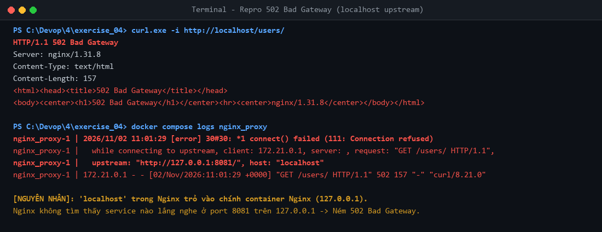
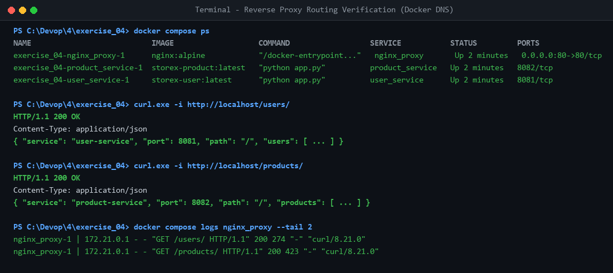

# StoreX DevOps Practice - Session 04: Docker Compose Ecosystem

- **Học viên:** NamNT (NamNTHE176286)
- **Repository:** [NamNT2942003/4](https://github.com/NamNT2942003/4)
- **Dự án thực hành:** StoreX Microservices Architecture (Backend Spring Boot, PostgreSQL, Redis, Nginx Reverse Proxy, User Service, Product Service)

---

## Danh mục bài tập hoàn thành (Session 04)

| Bài tập | Nội dung | File bàn giao | Minh chứng |
| :--- | :--- | :--- | :--- |
| **Bài tập 1** | Khởi tạo môi trường phát triển cơ bản & Sửa lỗi kết nối mạng (Service Name DNS) | `exercise_01/docker-compose.yml`<br>`README.md` | `evidence_01_error.png`<br>`evidence_02_success.png` |
| **Bài tập 2** | Quản lý dữ liệu bền vững (Volumes) và Dependency với Healthcheck (`service_healthy`) | `exercise_02/docker-compose.yml`<br>`HEALTHCHECK_EXPLANATION.md` | `evidence_01_startup_dependency.png`<br>`evidence_02_data_persistence.png` |
| **Bài tập 3** | Tối ưu hóa biến môi trường (`.env` / `.env.example`) & Cô lập mạng (`storex-net`) | `exercise_03/docker-compose.yml`<br>`exercise_03/.env.example`<br>`.gitignore` | `evidence_01_env_and_network.png`<br>`evidence_02_isolation_and_git.png` |
| **Bài tập 4** | Xây dựng hệ thống Reverse Proxy với Nginx & Định tuyến Microservices qua Docker DNS | `exercise_04/docker-compose.yml`<br>`exercise_04/nginx.conf` | `evidence_01_error_502.png`<br>`evidence_02_success_routing.png` |

---

## Chi tiết Bài tập 4: Xây dựng hệ thống Reverse Proxy với Nginx

### 1. Phân tích nguyên nhân lỗi `502 Bad Gateway`
- Trong file `nginx.conf` ban đầu, proxy được cấu hình trỏ tới:
  ```nginx
  proxy_pass http://localhost:8081/;
  ```
- **Bản chất kỹ thuật:** Trong kiến trúc container, `localhost` (hoặc `127.0.0.1`) bên trong container `nginx_proxy` trỏ về **chính network loopback của container Nginx**, chứ không phải máy host hay các container microservices.
- Vì container Nginx chỉ chạy tiến trình web server trên cổng 80, hoàn toàn không có tiến trình nào lắng nghe cổng 8081 hay 8082 trên `127.0.0.1` của nó.
- Khi nhận request `/users/`, Nginx cố gắng mở kết nối TCP tới `127.0.0.1:8081` và bị từ chối kết nối (`111: Connection refused`).
- Do upstream server không phản hồi kết nối, Nginx ném mã lỗi HTTP **`502 Bad Gateway`**.

### 2. Giải pháp khắc phục & Cơ chế Path Rewriting trong Nginx
1. **Sử dụng Docker Embedded DNS Name:**
   - Thay thế `localhost` bằng Service Name được định nghĩa trong `docker-compose.yml`:
     - `http://user_service:8081/`
     - `http://product_service:8082/`
2. **Cơ chế URI Stripping / Rewriting của `proxy_pass`:**
   - Khi `proxy_pass` có chứa URI (dấu gạch chéo `/` ở cuối): Nginx sẽ tự động cắt bỏ phần tiền tố khớp với `location /users/` và chuyển tiếp phần URI còn lại vào root `/` của upstream service.
   - Thêm location redirect `= /users` -> `/users/` và `= /products` -> `/products/` để hỗ trợ client gọi không có trailing slash.

---

### 3. File cấu hình Nginx ([exercise_04/nginx.conf](file:///C:/Devop/4/exercise_04/nginx.conf))

```nginx
server {
    listen 80;

    # Định tuyến tới User Service
    location /users/ {
        proxy_pass http://user_service:8081/;
        proxy_set_header Host $host;
        proxy_set_header X-Real-IP $remote_addr;
        proxy_set_header X-Forwarded-For $proxy_add_x_forwarded_for;
        proxy_set_header X-Forwarded-Proto $scheme;
    }

    location = /users {
        return 301 /users/;
    }

    # Định tuyến tới Product Service
    location /products/ {
        proxy_pass http://product_service:8082/;
        proxy_set_header Host $host;
        proxy_set_header X-Real-IP $remote_addr;
        proxy_set_header X-Forwarded-For $proxy_add_x_forwarded_for;
        proxy_set_header X-Forwarded-Proto $scheme;
    }

    location = /products {
        return 301 /products/;
    }
}
```

### 4. File cấu hình Docker Compose ([exercise_04/docker-compose.yml](file:///C:/Devop/4/exercise_04/docker-compose.yml))

```yaml
version: '3.8'

services:
  nginx_proxy:
    image: nginx:alpine
    ports:
      - "80:80"
    volumes:
      - ./nginx.conf:/etc/nginx/conf.d/default.conf
    depends_on:
      - user_service
      - product_service

  user_service:
    image: storex-user:latest

  product_service:
    image: storex-product:latest
```

---

### 5. Minh chứng thực nghiệm

#### 5.1. Tái hiện lỗi 502 Bad Gateway ban đầu


```text
HTTP/1.1 502 Bad Gateway
Server: nginx/1.31.8

nginx_proxy-1 | 2026/11/02 11:01:29 [error] 30#30: *1 connect() failed (111: Connection refused) while connecting to upstream, upstream: "http://127.0.0.1:8081/"
```

#### 5.2. Định tuyến thành công qua Nginx Reverse Proxy


1. **Request tới User Service:**
   ```bash
   curl -i http://localhost/users/
   ```
   ```http
   HTTP/1.1 200 OK
   Server: nginx/1.31.8
   Content-Type: application/json

   {
     "service": "user-service",
     "port": 8081,
     "path": "/",
     "users": [
       { "id": 1, "name": "Nam Nguyen", "role": "DevOps Engineer" },
       { "id": 2, "name": "Admin StoreX", "role": "System Administrator" }
     ]
   }
   ```

2. **Request tới Product Service:**
   ```bash
   curl -i http://localhost/products/
   ```
   ```http
   HTTP/1.1 200 OK
   Server: nginx/1.31.8
   Content-Type: application/json

   {
     "service": "product-service",
     "port": 8082,
     "path": "/",
     "products": [
       { "id": 101, "name": "Apple MacBook Pro M3", "price": 2200 },
       { "id": 102, "name": "Dell XPS 15 OLED", "price": 1850 }
     ]
   }
   ```

3. **Nginx Access Log:**
   ```text
   nginx_proxy-1 | 172.21.0.1 - - "GET /users/ HTTP/1.1" 200 274 "-" "curl/8.21.0"
   nginx_proxy-1 | 172.21.0.1 - - "GET /products/ HTTP/1.1" 200 423 "-" "curl/8.21.0"
   ```

---

## Chi tiết các bài tập trước
* **Bài tập 1:** Thư mục [`exercise_01/`](file:///C:/Devop/4/exercise_01/)
* **Bài tập 2:** Thư mục [`exercise_02/`](file:///C:/Devop/4/exercise_02/) & [`HEALTHCHECK_EXPLANATION.md`](file:///C:/Devop/4/HEALTHCHECK_EXPLANATION.md)
* **Bài tập 3:** Thư mục [`exercise_03/`](file:///C:/Devop/4/exercise_03/)
