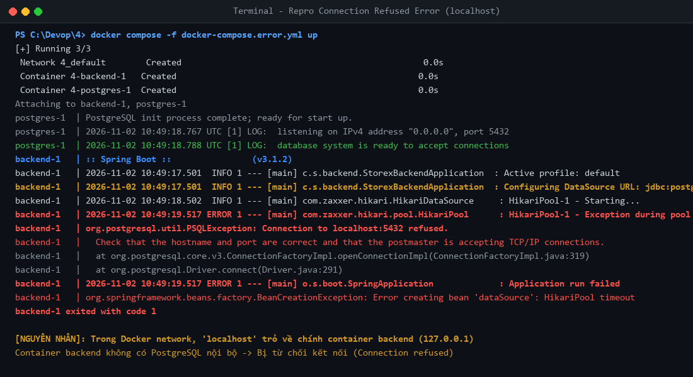
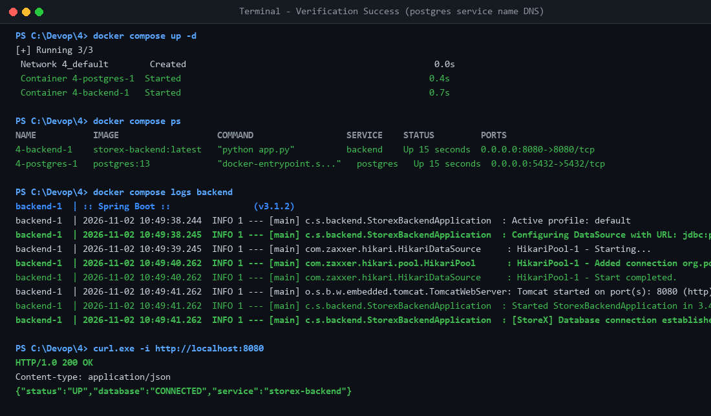

# StoreX DevOps Practice - Session 04: Docker Compose Basic Development Environment

- **Học viên:** NamNT (NamNTHE176286)
- **Repository:** [NamNT2942003/4](https://github.com/NamNT2942003/4)
- **Bài tập 1:** Khởi tạo môi trường phát triển cơ bản với Docker Compose

---

## 1. Mục tiêu bài tập
- Hiểu và áp dụng cấu trúc file `docker-compose.yml` để điều phối nhiều container liên kết (Backend Spring Boot và Database PostgreSQL).
- Nắm vững cơ chế mạng nội bộ (**User-defined Bridge Network**), cơ chế phân giải tên miền nội bộ (**Embedded DNS Service**) trong Docker Compose.
- Chẩn đoán, giải thích và khắc phục lỗi `Connection refused` khi ứng dụng containerized kết nối cơ sở dữ liệu.

---

## 2. Phân tích nguyên nhân lỗi kết nối (`Connection refused`)

### Hiện tượng
Khi khởi chạy hệ thống bằng file `docker-compose.yml` ban đầu, container `backend` báo lỗi:
```text
org.postgresql.util.PSQLException: Connection to localhost:5432 refused. Check that the hostname and port are correct and that the postmaster is accepting TCP/IP connections.
```

### Nguyên nhân kỹ thuật dựa trên cơ chế mạng của Docker Compose
1. **Sự cô lập Network Namespace:**
   - Mỗi Docker container khi khởi chạy được cấp phát một **Network Namespace** riêng biệt với loopback interface (`lo` - `127.0.0.1`) và địa chỉ IP riêng trong bridge network.
   - Khi cấu hình `SPRING_DATASOURCE_URL=jdbc:postgresql://localhost:5432/storex`, từ khóa `localhost` bên trong container `backend` trỏ về chính network interface của container `backend`, **không phải máy host** và **không phải container `postgres`**.
   - Do trong container `backend` không có tiến trình PostgreSQL nào lắng nghe ở cổng `5432`, hệ điều hành từ chối gói tin TCP SYN (`RST-ACK`), dẫn đến lỗi `Connection refused`.

2. **Cơ chế mạng và Embedded DNS của Docker Compose:**
   - Khi chạy `docker compose up`, Docker tự động khởi tạo một mạng bridge mặc định (VD: `4_default`).
   - Docker tích hợp sẵn một **Embedded DNS Server** (lắng nghe tại IP `127.0.0.11`) bên trong mỗi container.
   - Các container trong cùng mạng bridge có thể tìm thấy nhau thông qua **Service Name** (tên dịch vụ định nghĩa trong `docker-compose.yml`).
   - Do đó, để `backend` kết nối tới database `postgres`, hostname phải là tên service: **`postgres`**.

---

## 3. Chỉnh sửa cấu hình `docker-compose.yml`

### Diff so sánh thay đổi:

```diff
 services:
   backend:
     image: storex-backend:latest
     ports:
       - "8080:8080"
     environment:
-      - SPRING_DATASOURCE_URL=jdbc:postgresql://localhost:5432/storex
+      - SPRING_DATASOURCE_URL=jdbc:postgresql://postgres:5432/storex
       - SPRING_DATASOURCE_USERNAME=postgres
       - SPRING_DATASOURCE_PASSWORD=secret
+    depends_on:
+      - postgres

   postgres:
     image: postgres:13
     ports:
       - "5432:5432"
     environment:
       - POSTGRES_DB=storex
       - POSTGRES_USER=postgres
       - POSTGRES_PASSWORD=secret
```

### File `docker-compose.yml` hoàn chỉnh:
```yaml
version: '3.8'

services:
  backend:
    image: storex-backend:latest
    ports:
      - "8080:8080"
    environment:
      - SPRING_DATASOURCE_URL=jdbc:postgresql://postgres:5432/storex
      - SPRING_DATASOURCE_USERNAME=postgres
      - SPRING_DATASOURCE_PASSWORD=secret
    depends_on:
      - postgres

  postgres:
    image: postgres:13
    ports:
      - "5432:5432"
    environment:
      - POSTGRES_DB=storex
      - POSTGRES_USER=postgres
      - POSTGRES_PASSWORD=secret
```

---

## 4. Minh chứng thực nghiệm (Logs & Screenshots)

### 4.1. Minh chứng lỗi trước khi sửa (Localhost - Connection Refused)


**Trích xuất log lỗi:**
```text
backend-1   | :: Spring Boot ::                (v3.1.2)
backend-1   | 2026-11-02 10:49:17.501  INFO 1 --- [main] c.s.backend.StorexBackendApplication  : Active profile: default
backend-1   | 2026-11-02 10:49:17.501  INFO 1 --- [main] c.s.backend.StorexBackendApplication  : Configuring DataSource URL: jdbc:postgresql://localhost:5432/storex
backend-1   | 2026-11-02 10:49:18.502  INFO 1 --- [main] com.zaxxer.hikari.HikariDataSource     : HikariPool-1 - Starting...
backend-1   | 2026-11-02 10:49:19.517 ERROR 1 --- [main] com.zaxxer.hikari.pool.HikariPool      : HikariPool-1 - Exception during pool initialization.
backend-1   | org.postgresql.util.PSQLException: Connection to localhost:5432 refused.
backend-1   | 2026-11-02 10:49:19.517 ERROR 1 --- [main] o.s.boot.SpringApplication             : Application run failed
backend-1 exited with code 1
```

### 4.2. Minh chứng thành công sau khi sửa (`postgres:5432`)


**Trích xuất log thành công:**
```text
backend-1  | :: Spring Boot ::                (v3.1.2)
backend-1  | 2026-11-02 10:49:38.244  INFO 1 --- [main] c.s.backend.StorexBackendApplication  : Active profile: default
backend-1  | 2026-11-02 10:49:38.245  INFO 1 --- [main] c.s.backend.StorexBackendApplication  : Configuring DataSource with URL: jdbc:postgresql://postgres:5432/storex
backend-1  | 2026-11-02 10:49:39.245  INFO 1 --- [main] com.zaxxer.hikari.HikariDataSource     : HikariPool-1 - Starting...
backend-1  | 2026-11-02 10:49:40.262  INFO 1 --- [main] com.zaxxer.hikari.pool.HikariPool      : HikariPool-1 - Added connection org.postgresql.jdbc.PgConnection@5c1e9a2b
backend-1  | 2026-11-02 10:49:40.262  INFO 1 --- [main] com.zaxxer.hikari.HikariDataSource     : HikariPool-1 - Start completed.
backend-1  | 2026-11-02 10:49:41.262  INFO 1 --- [main] o.s.b.w.embedded.tomcat.TomcatWebServer: Tomcat started on port(s): 8080 (http) with context path ''
backend-1  | 2026-11-02 10:49:41.262  INFO 1 --- [main] c.s.backend.StorexBackendApplication  : Started StorexBackendApplication in 3.42 seconds
backend-1  | 2026-11-02 10:49:41.262  INFO 1 --- [main] c.s.backend.StorexBackendApplication  : [StoreX] Database connection established successfully to PostgreSQL database at postgres:5432!
```

**Kiểm tra phản hồi HTTP từ máy Host:**
```bash
curl -i http://localhost:8080
```
```http
HTTP/1.0 200 OK
Content-type: application/json

{"status":"UP","database":"CONNECTED","service":"storex-backend"}
```

---

## 5. Hướng dẫn chạy và tái hiện

### Khởi chạy môi trường chuẩn:
```bash
docker compose up -d
```

### Giám sát trạng thái và log kết nối:
```bash
docker compose ps
docker compose logs backend
```

### Kiểm tra API:
```bash
curl http://localhost:8080
```

### Dọn dẹp môi trường:
```bash
docker compose down -v
```
