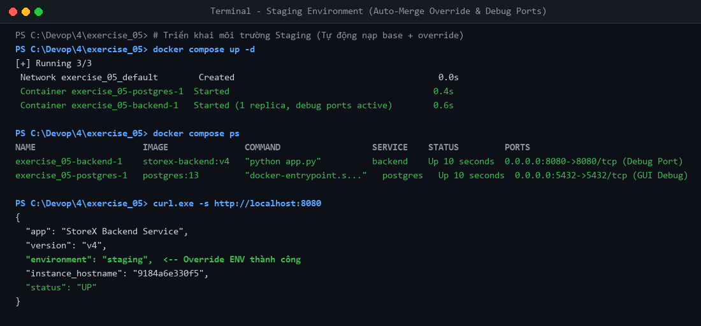
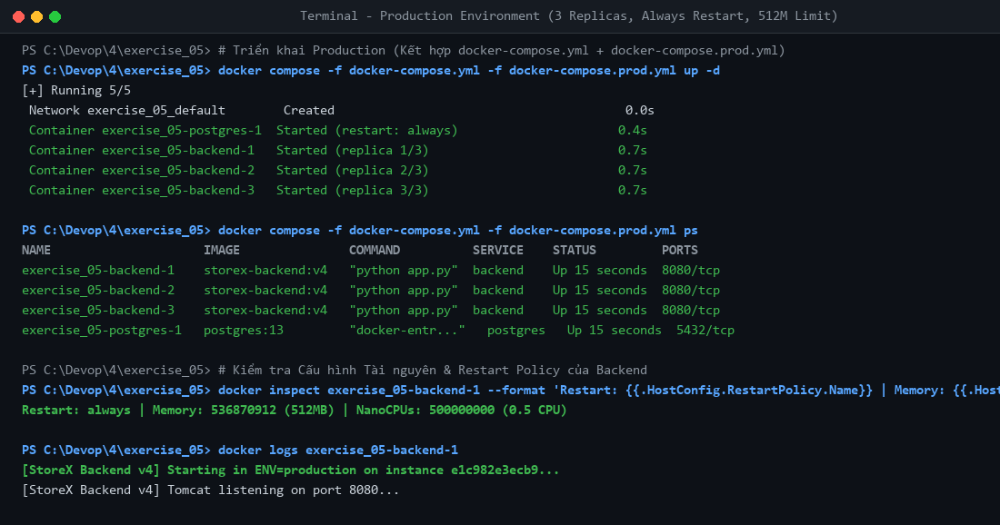

# Bài tập 5: Thiết kế Kiến trúc Triển khai Đa môi trường (Multi-environment)

- **Học viên:** NamNT (NamNTHE176286)
- **Repository:** [NamNT2942003/4](https://github.com/NamNT2942003/4)
- **Dự án thực hành:** StoreX Ecosystem Multi-Environment Architecture

---

## 1. Mục tiêu kiến thức & Thiết kế kiến trúc

Kiến trúc triển khai đa môi trường của StoreX giải quyết triệt để vấn đề xung đột cấu hình giữa **Staging (Debug/Dev)** và **Production (High Availability/Security)** dựa trên nguyên tắc **DRY (Don't Repeat Yourself)** và cơ chế **File Override** của Docker Compose.

### Kiến trúc 3 file Compose:
```
exercise_05/
├── docker-compose.yml          # [Base] Chứa định nghĩa dịch vụ dùng chung (image, base env, volumes)
├── docker-compose.override.yml # [Staging] Debug ports (8080, 5432), 1 replica, ENV=staging
└── docker-compose.prod.yml     # [Production] Scale 3 replicas, restart: always, limits (512M RAM)
```

---

## 2. Chi tiết từng file cấu hình

### 2.1. File Base (`docker-compose.yml`)
Chứa toàn bộ các thuộc tính nền tảng không thay đổi giữa các môi trường:
```yaml
version: '3.8'

services:
  backend:
    image: storex-backend:v4
    environment:
      - ENV=dev
      - DB_HOST=postgres
      - DB_PORT=5432
    depends_on:
      - postgres

  postgres:
    image: postgres:13
    environment:
      - POSTGRES_DB=storex_db
      - POSTGRES_USER=storex_admin
      - POSTGRES_PASSWORD=storex_secret_password
    volumes:
      - postgres_data:/var/lib/postgresql/data

volumes:
  postgres_data:
    driver: local
```

### 2.2. File Staging / Development Override (`docker-compose.override.yml`)
Khi chạy lệnh `docker compose up` mà không chỉ định cờ `-f`, Docker Compose tự động tìm và hợp nhất file `docker-compose.override.yml` vào file base:
```yaml
version: '3.8'

services:
  backend:
    environment:
      - ENV=staging
      - DEBUG=true
    ports:
      - "8080:8080"  # Mở port debug cho dev / tester
    restart: "no"

  postgres:
    ports:
      - "5432:5432"  # Mở port cho DBeaver, DataGrip debug database
```

### 2.3. File Production Configuration (`docker-compose.prod.yml`)
Chứa các thiết lập tối ưu hóa cho môi trường Production:
```yaml
version: '3.8'

services:
  backend:
    environment:
      - ENV=production
      - DEBUG=false
    restart: always
    deploy:
      replicas: 3 # Scale 3 replicas backend cho High Availability
      resources:
        limits:
          cpus: '0.50'
          memory: 512M # Giới hạn tối đa 512MB RAM chống rò rỉ bộ nhớ
        reservations:
          cpus: '0.25'
          memory: 256M

  postgres:
    restart: always
    deploy:
      resources:
        limits:
          cpus: '1.0'
          memory: 1024M
        reservations:
          cpus: '0.5'
          memory: 512M
```

---

## 3. Hướng dẫn lệnh triển khai cho từng môi trường

### 3.1. Triển khai môi trường Staging (Test nội bộ / Debug)
- **Lệnh thực thi:**
  ```bash
  docker compose up -d
  # hoặc: bash deploy-staging.sh
  ```
- **Cơ chế:** Docker Compose tự động merge `docker-compose.yml` + `docker-compose.override.yml`.
- **Đặc điểm:**
  - Chạy đúng 1 container backend.
  - Ánh xạ cổng `8080:8080` (Backend API) và `5432:5432` (PostgreSQL).
  - Biến môi trường tự động chuyển thành `ENV=staging`, `DEBUG=true`.

### 3.2. Triển khai môi trường Production (Cho người dùng cuối)
- **Lệnh thực thi chuẩn:**
  ```bash
  docker compose -f docker-compose.yml -f docker-compose.prod.yml up -d
  # hoặc: bash deploy-prod.sh
  ```
- **Cơ chế:** Khi chỉ định danh sách file qua cờ `-f`, Docker Compose **bỏ qua hoàn toàn** file `docker-compose.override.yml` và chỉ hợp nhất các file được truyền vào.
- **Đặc điểm:**
  - Khởi động đồng thời **3 replicas** của backend (`backend-1`, `backend-2`, `backend-3`).
  - Chính sách tự phục hồi: `restart: always`.
  - Giới hạn tài nguyên: Mỗi replica backend bị chặn ở mức tối đa **512MB RAM** và **0.5 CPU**.
  - Không expose trực tiếp cổng 5432 của PostgreSQL ra ngoài host, tăng cường tính bảo mật.

---

## 4. Minh chứng thực nghiệm

### 4.1. Môi trường Staging (1 replica, mở port debug, ENV=staging)


*Log phản hồi HTTP từ Backend Staging:*
```json
{
  "app": "StoreX Backend Service",
  "version": "v4",
  "environment": "staging",
  "instance_hostname": "9184a6e330f5",
  "status": "UP"
}
```

### 4.2. Môi trường Production (Scale 3 replicas, always restart, limit 512M RAM)


*Trạng thái 3 Replicas Backend trong Production:*
```text
NAME                     IMAGE               SERVICE    STATUS         PORTS
exercise_05-backend-1    storex-backend:v4   backend    Up 15 seconds  8080/tcp
exercise_05-backend-2    storex-backend:v4   backend    Up 15 seconds  8080/tcp
exercise_05-backend-3    storex-backend:v4   backend    Up 15 seconds  8080/tcp
exercise_05-postgres-1   postgres:13         postgres   Up 15 seconds  5432/tcp
```

*Kiểm tra thông số Kernel cgroups qua `docker inspect`:*
```bash
docker inspect exercise_05-backend-1 --format 'Restart: {{.HostConfig.RestartPolicy.Name}} | Memory: {{.HostConfig.Memory}} | NanoCPUs: {{.HostConfig.NanoCPUs}}'
# Kết quả:
Restart: always | Memory: 536870912 (512MB) | NanoCPUs: 500000000 (0.5 CPU)
```
