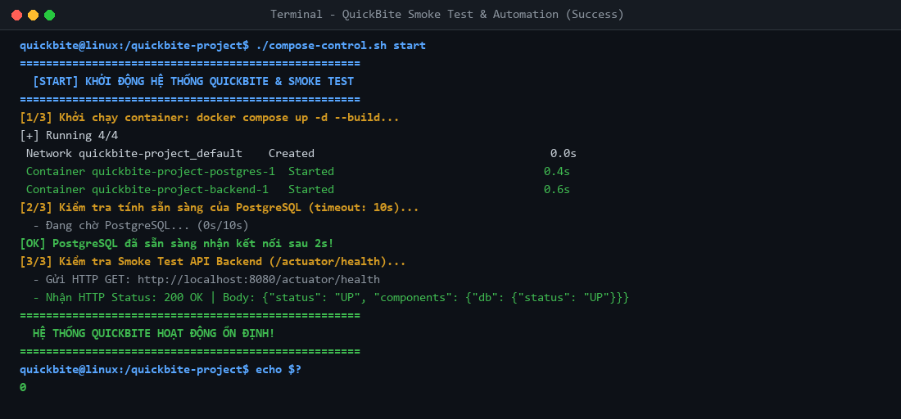
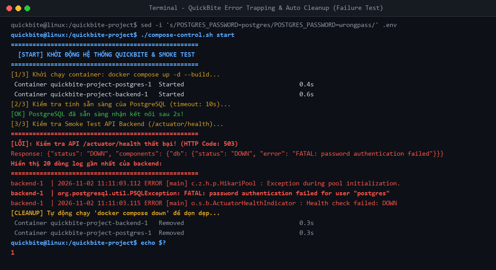

# Kịch bản Shell Script vận hành & Smoke Test (compose-control.sh)

- **Học viên:** NamNT (NamNTHE176286)
- **Repository:** [NamNT2942003/4](https://github.com/NamNT2942003/4)
- **Dự án thực hành:** QuickBite Ecosystem Management Automation (`/quickbite-project/`)

---

## 1. Mục tiêu kiến thức & Thiết kế kịch bản
- **Tự động hóa toàn diện:** Đóng gói toàn bộ vòng đời khởi động, kiểm tra sức khỏe và thu dọn stack container thành 1 script duy nhất `compose-control.sh`.
- **Cơ chế bẫy lỗi (Fail-fast Error Trapping):**
  - Giám sát readiness của cơ sở dữ liệu qua `pg_isready` trong 10 giây (polling mỗi 2 giây).
  - Giám sát endpoint nghiệp vụ `/actuator/health` của Backend.
  - Tự động phát hiện bất thường, in log màu đỏ, trích xuất 20 dòng log sự cố của backend và tự động dọn dẹp môi trường (`docker compose down`).

---

## 2. Cú pháp sử dụng
Kịch bản nhận 3 tham số lệnh:
```bash
./compose-control.sh [start | stop | clean]
```
- **`start`**:
  1. Chạy `docker compose up -d --build`.
  2. Vòng lặp thăm dò `pg_isready` mỗi 2s (tối đa 10s).
  3. Kiểm tra HTTP GET `/actuator/health`. Nếu status = 200 và body chứa `"status":"UP"`: in dòng chữ màu xanh lá `HỆ THỐNG QUICKBITE HOẠT ĐỘNG ỔN ĐỊNH!` và thoát mã `0`.
  4. Nếu quá timeout hoặc API lỗi: In cảnh báo màu đỏ, trích xuất 20 dòng log backend, tự động chạy `docker compose down` và thoát mã `1`.
- **`stop`**: Tạm dừng hệ thống bằng `docker compose stop`.
- **`clean`**: Xóa sạch toàn bộ container, networks và volumes bằng `docker compose down -v`.

---

## 3. Nội dung file mã nguồn (`compose-control.sh`)

```bash
#!/bin/bash
# ==============================================================================
# Script vận hành & Smoke Test tự động cho hệ thống QuickBite
# Vị trí: /quickbite-project/compose-control.sh
# Cách dùng: ./compose-control.sh [start | stop | clean]
# ==============================================================================

# Định nghĩa mã màu ANSI cho output
RED='\033[0;31m'
GREEN='\033[0;32m'
YELLOW='\033[1;33m'
BLUE='\033[0;34m'
NC='\033[0m' # No Color

# Nạp biến môi trường từ .env nếu tồn tại
if [ -f .env ]; then
  export $(grep -v '^#' .env | xargs)
fi

DB_USER="${POSTGRES_USER:-postgres}"
DB_NAME="${POSTGRES_DB:-quickbite}"
BACKEND_HEALTH_URL="http://localhost:8080/actuator/health"

case "$1" in
  start)
    echo -e "${BLUE}====================================================${NC}"
    echo -e "${BLUE}  [START] KHỞI ĐỘNG HỆ THỐNG QUICKBITE & SMOKE TEST  ${NC}"
    echo -e "${BLUE}====================================================${NC}"
    
    echo -e "${YELLOW}[1/3] Khởi chạy container: docker compose up -d --build...${NC}"
    if ! docker compose up -d --build; then
      echo -e "${RED}[ERROR] Không thể khởi chạy Docker Compose stack!${NC}"
      exit 1
    fi

    echo -e "${YELLOW}[2/3] Kiểm tra tính sẵn sàng của PostgreSQL (timeout: 10s)...${NC}"
    elapsed=0
    timeout=10
    interval=2
    db_ready=0

    while [ $elapsed -lt $timeout ]; do
      if docker compose exec -T postgres pg_isready -U "$DB_USER" -d "$DB_NAME" >/dev/null 2>&1; then
        db_ready=1
        echo -e "${GREEN}[OK] PostgreSQL đã sẵn sàng nhận kết nối sau ${elapsed}s!${NC}"
        break
      fi
      echo -e "  - Đang chờ PostgreSQL... (${elapsed}s/${timeout}s)"
      sleep $interval
      elapsed=$((elapsed + interval))
    done

    if [ $db_ready -eq 0 ]; then
      echo -e "${RED}====================================================${NC}"
      echo -e "${RED}[LỖI]: PostgreSQL không sẵn sàng sau ${timeout}s timeout!${NC}"
      echo -e "${RED}Hiển thị 20 dòng log gần nhất của backend:${NC}"
      echo -e "${RED}====================================================${NC}"
      docker compose logs backend --tail 20
      echo -e "${YELLOW}[CLEANUP] Tự động dọn dẹp hệ thống do khởi động thất bại...${NC}"
      docker compose down
      exit 1
    fi

    echo -e "${YELLOW}[3/3] Kiểm tra Smoke Test API Backend (/actuator/health)...${NC}"
    sleep 2
    
    health_response=$(curl -s -w "\n%{http_code}" "$BACKEND_HEALTH_URL" 2>/dev/null)
    http_code=$(echo "$health_response" | tail -n 1)
    body=$(echo "$health_response" | sed '$d')

    if [ "$http_code" = "200" ] && echo "$body" | grep -q '"status":[ ]*"UP"'; then
      echo -e "${GREEN}====================================================${NC}"
      echo -e "${GREEN}  HỆ THỐNG QUICKBITE HOẠT ĐỘNG ỔN ĐỊNH!            ${NC}"
      echo -e "${GREEN}====================================================${NC}"
      exit 0
    else
      echo -e "${RED}====================================================${NC}"
      echo -e "${RED}[LỖI]: Kiểm tra API /actuator/health thất bại! (HTTP Code: ${http_code:-N/A})${NC}"
      echo -e "${RED}Response: ${body:-Empty / Connection refused}${NC}"
      echo -e "${RED}Hiển thị 20 dòng log gần nhất của backend:${NC}"
      echo -e "${RED}====================================================${NC}"
      docker compose logs backend --tail 20
      echo -e "${YELLOW}[CLEANUP] Tự động chạy 'docker compose down' để dọn dẹp...${NC}"
      docker compose down
      exit 1
    fi
    ;;

  stop)
    echo -e "${YELLOW}====================================================${NC}"
    echo -e "${YELLOW}  [STOP] TẠM DỪNG HỆ THỐNG QUICKBITE               ${NC}"
    echo -e "${YELLOW}====================================================${NC}"
    docker compose stop
    echo -e "${GREEN}[OK] Đã tạm dừng toàn bộ container hệ thống.${NC}"
    ;;

  clean)
    echo -e "${YELLOW}====================================================${NC}"
    echo -e "${YELLOW}  [CLEAN] DỌN DẸP SẠCH SẼ TÀI NGUYÊN HỆ THỐNG      ${NC}"
    echo -e "${YELLOW}====================================================${NC}"
    docker compose down -v
    echo -e "${GREEN}[OK] Đã dọn dẹp sạch sẽ toàn bộ container, networks và volumes.${NC}"
    ;;

  *)
    echo -e "${RED}Lỗi cú pháp tham số!${NC}"
    echo -e "Cách sử dụng: $0 [start | stop | clean]"
    exit 1
    ;;
esac
```

---

## 4. Minh chứng thực nghiệm

### 4.1. Luồng chạy thành công (`control_success.png`)


- PostgreSQL sẵn sàng nhận kết nối.
- API `/actuator/health` trả về `200 OK` với body status `UP`.
- In thông báo màu xanh lá: `HỆ THỐNG QUICKBITE HOẠT ĐỘNG ỔN ĐỊNH!` và thoát mã `0`.

### 4.2. Luồng test bẫy lỗi khi cấu hình sai mật khẩu (`control_failure.png`)


- Sửa sai mật khẩu trong `.env`.
- API `/actuator/health` trả về mã lỗi 503 (`status: DOWN`).
- Script phát hiện lỗi, in thông báo đỏ, in 20 dòng log của backend giải thích nguyên nhân (`FATAL: password authentication failed`).
- Tự động gọi `docker compose down` dọn dẹp container và thoát mã `1`.
