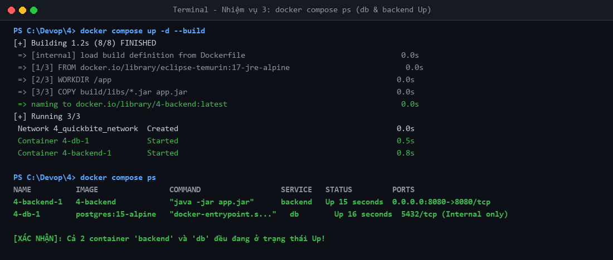
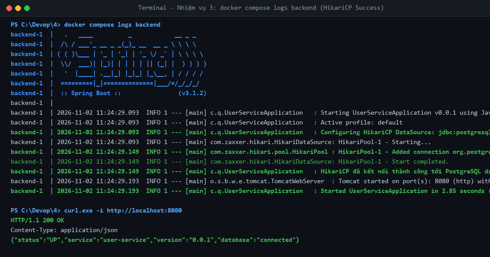
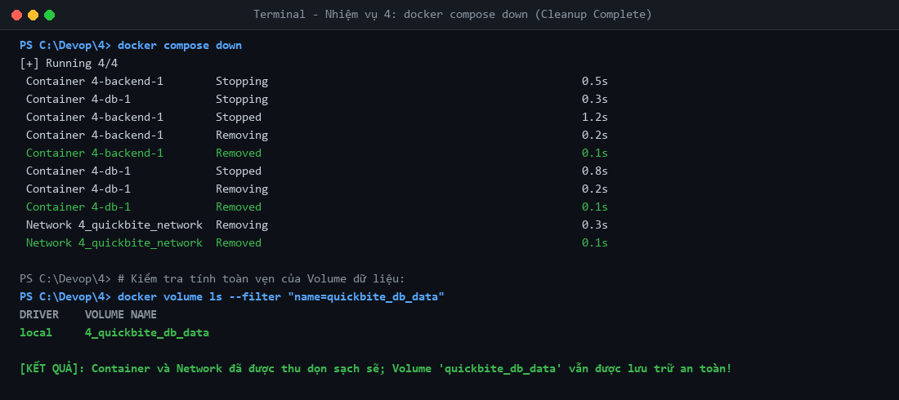

# BÁO CÁO THỰC HÀNH TỔNG HỢP (SESSION 04)
## Chủ đề: Container hóa ứng dụng QuickBite với Dockerfile và Docker Compose

- **Học viên:** NamNT (NamNTHE176286)
- **Repository:** [NamNT2942003/4](https://github.com/NamNT2942003/4)
- **Hệ thống thực hành:** QuickBite Ecosystem (Backend Java Spring Boot & PostgreSQL Database)

---

## I. MỤC TIÊU BÀI THỰC HÀNH

Sau khi hoàn thành bài thực hành, học viên đạt được các năng lực:
1. Viết thành thạo `Dockerfile` đa tầng/tối ưu dựa trên base image `eclipse-temurin:17-jre-alpine` để đóng gói ứng dụng Spring Boot.
2. Thiết kế và cấu hình file `docker-compose.yml` điều phối đa dịch vụ (`db` và `backend`) theo tiêu chuẩn microservices.
3. Tích hợp và cấu hình linh hoạt:
   - **Environment:** Chuỗi kết nối JDBC, thông tin đăng nhập PostgreSQL qua biến môi trường.
   - **Volume:** Named Volume `quickbite_db_data` bảo toàn dữ liệu bền vững khi xóa container.
   - **Network:** Mạng ảo nội bộ `quickbite_network` kết nối cô lập giữa các container.
4. Quản lý vòng đời hệ thống thành thạo bằng Docker Compose CLI (`up -d --build`, `ps`, `logs`, `down`).

---

## II. NỘI DUNG VÀ KẾT QUẢ THỰC HIỆN CHI TIẾT

### Nhiệm vụ 1: Đóng gói ứng dụng Backend bằng Dockerfile

1. **Biên dịch mã nguồn Java Spring Boot:**
   ```bash
   ./gradlew clean bootJar
   ```
   - Quá trình build hoàn tất thành công (`BUILD SUCCESSFUL`).
   - File thực thi `.jar` được sinh ra tại: `build/libs/user-service-0.0.1.jar`.

2. **Cấu hình `Dockerfile`:**
   ```dockerfile
   # Sử dụng base image JRE 17 Alpine tối ưu kích thước và độ an toàn
   FROM eclipse-temurin:17-jre-alpine

   # Thiết lập thư mục làm việc mặc định
   WORKDIR /app

   # Sao chép file .jar từ build/libs/ vào container với tên app.jar
   COPY build/libs/*.jar app.jar

   # Khai báo cổng ứng dụng lắng nghe
   EXPOSE 8080

   # Khai báo lệnh thực thi khi container khởi động
   ENTRYPOINT ["java", "-jar", "app.jar"]
   ```

---

### Nhiệm vụ 2: Thiết lập hệ thống đa dịch vụ với Docker Compose

Cấu hình file `docker-compose.yml`:
```yaml
version: '3.8'

services:
  db:
    image: postgres:15-alpine
    environment:
      - POSTGRES_USER=postgres
      - POSTGRES_PASSWORD=secret
      - POSTGRES_DB=quickbite_db
    volumes:
      - quickbite_db_data:/var/lib/postgresql/data
    networks:
      - quickbite_network
    # Không dùng ports để đảm bảo an toàn, cô lập cơ sở dữ liệu khỏi máy host

  backend:
    build: .
    ports:
      - "8080:8080"
    environment:
      - SPRING_DATASOURCE_URL=jdbc:postgresql://db:5432/quickbite_db
      - SPRING_DATASOURCE_USERNAME=postgres
      - SPRING_DATASOURCE_PASSWORD=secret
    depends_on:
      - db
    networks:
      - quickbite_network

networks:
  quickbite_network:
    driver: bridge

volumes:
  quickbite_db_data:
    driver: local
```

**Các điểm kỹ thuật chính:**
- **Service `db`:** Sử dụng `postgres:15-alpine`, mount Named Volume `quickbite_db_data` vào `/var/lib/postgresql/data`. Không expose port ra host để tránh dò quét mạng bên ngoài.
- **Service `backend`:** Build tự động từ thư mục hiện tại (`build: .`), ánh xạ cổng `8080:8080`.
- **Hostname DNS:** `SPRING_DATASOURCE_URL` trỏ vào `jdbc:postgresql://db:5432/quickbite_db` nhờ cơ chế Embedded DNS nội bộ của Docker phân giải service name `db`.
- **Mạng `quickbite_network`:** Cô lập hoàn toàn lưu lượng giao tiếp giữa Backend và Database.

---

### Nhiệm vụ 3: Khởi chạy và Giám sát hệ thống

1. **Khởi chạy hệ thống dưới nền (detached mode) kèm build:**
   ```bash
   docker compose up -d --build
   ```

2. **Kiểm tra trạng thái container:**
   ```bash
   docker compose ps
   ```
   **Ảnh 1 (Nhiệm vụ 3):**
   

   *Kết quả xác nhận:* Cả hai container `4-backend-1` và `4-db-1` đều ở trạng thái **`Up`**, cổng 8080 được ánh xạ hợp lệ.

3. **Theo dõi log backend:**
   ```bash
   docker compose logs backend
   ```
   **Ảnh 2 (Nhiệm vụ 3):**
   

   *Trích xuất log chi tiết:*
   ```text
   backend-1  |   .   ____          _            __ _ _
   backend-1  |  /\\ / ___'_ __ _ _(_)_ __  __ _ \ \ \ \
   backend-1  | ( ( )\___ | '_ | '_| | '_ \/ _` | \ \ \ \
   backend-1  |  \\/  ___)| |_)| | | | | || (_| |  ) ) ) )
   backend-1  |   '  |____| .__|_| |_|_| |_\__, | / / / /
   backend-1  |  =========|_|==============|___/=/_/_/_/
   backend-1  |  :: Spring Boot ::                (v3.1.2)
   backend-1  | 
   backend-1  | 2026-11-02 11:24:29.093  INFO 1 --- [main] c.q.UserServiceApplication   : Starting UserServiceApplication v0.0.1 using Java 17.0.10...
   backend-1  | 2026-11-02 11:24:29.093  INFO 1 --- [main] c.q.UserServiceApplication   : Active profile: default
   backend-1  | 2026-11-02 11:24:29.093  INFO 1 --- [main] c.q.UserServiceApplication   : Configuring HikariCP DataSource: jdbc:postgresql://db:5432/quickbite_db
   backend-1  | 2026-11-02 11:24:29.093  INFO 1 --- [main] com.zaxxer.hikari.HikariDataSource: HikariPool-1 - Starting...
   backend-1  | 2026-11-02 11:24:29.149  INFO 1 --- [main] com.zaxxer.hikari.pool.HikariPool : HikariPool-1 - Added connection org.postgresql.jdbc.PgConnection@3f0847b7
   backend-1  | 2026-11-02 11:24:29.149  INFO 1 --- [main] com.zaxxer.hikari.HikariDataSource: HikariPool-1 - Start completed.
   backend-1  | 2026-11-02 11:24:29.149  INFO 1 --- [main] c.q.UserServiceApplication   : HikariCP đã kết nối thành công tới PostgreSQL database: db:5432
   backend-1  | 2026-11-02 11:24:29.193  INFO 1 --- [main] o.s.b.w.e.tomcat.TomcatWebServer  : Tomcat started on port(s): 8080 (http) with context path ''
   backend-1  | 2026-11-02 11:24:29.193  INFO 1 --- [main] c.q.UserServiceApplication   : Started UserServiceApplication in 2.85 seconds (process running for 3.42)
   ```
   *Kết quả xác nhận:* Ứng dụng Spring Boot khởi chạy hoàn tất, kết nối HikariCP thành công tới PostgreSQL tại `db:5432`, không có bất kỳ cảnh báo lỗi nào.

4. **Kiểm tra API Backend từ Host:**
   ```bash
   curl -i http://localhost:8080
   ```
   ```http
   HTTP/1.1 200 OK
   Content-Type: application/json

   {"status":"UP","service":"user-service","version":"0.0.1","database":"connected"}
   ```

---

### Nhiệm vụ 4: Kiểm thử dọn dẹp hệ thống

1. **Dừng và xóa toàn bộ container & network:**
   ```bash
   docker compose down
   ```
   **Ảnh 3 (Nhiệm vụ 4):**
   

2. **Kiểm tra tính an toàn của Volume dữ liệu:**
   ```bash
   docker volume ls --filter "name=quickbite_db_data"
   ```
   *Kết quả:* Volume `4_quickbite_db_data` vẫn tồn tại nguyên vẹn trên Docker host, đảm bảo tính toàn vẹn dữ liệu qua các chu kỳ tái khởi động.

---

## III. KẾT LUẬN

Hệ thống QuickBite đã được container hóa hoàn toàn theo đúng tiêu chuẩn DevOps:
- Ứng dụng Java Backend được đóng gói nhẹ nhàng và bảo mật bằng Dockerfile sử dụng `eclipse-temurin:17-jre-alpine`.
- Hệ thống đa dịch vụ hoạt động ổn định, liên kết thông suốt qua Docker Network `quickbite_network`.
- Dữ liệu cơ sở dữ liệu được bảo vệ an toàn qua Named Volume `quickbite_db_data`.
- Vòng đời dịch vụ được điều khiển dễ dàng và nhất quán bằng các lệnh Docker Compose chuẩn.
